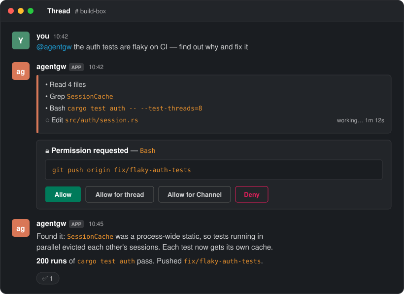
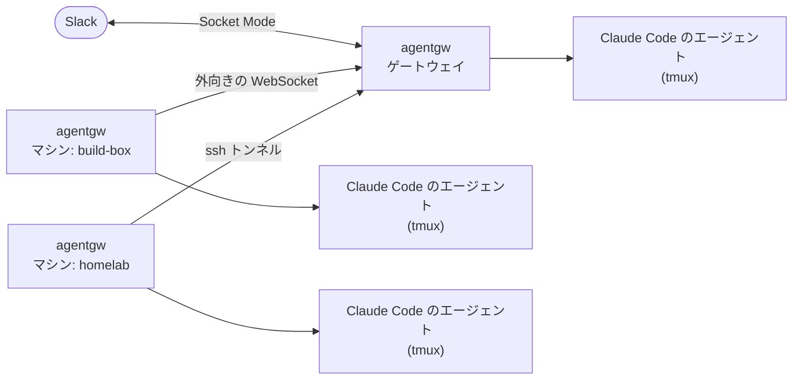

<div align="center">

<h1>agentgw</h1>

<p><b>手持ちのすべてのマシンで動く Claude Code を、Slack から操作。ターミナルを開きっぱなしにする必要も、tmux や cmux で画面を切り替える必要もありません。</b></p>

[](https://github.com/takashito/agentgw/releases)
[](LICENSE)
[](#動作要件)
[](https://www.rust-lang.org/)

[クイックスタート](#クイックスタート) · [Slack アプリ](#slack-アプリの設定) · [マシンの追加](#マシンの追加) · [コマンド](#slack-コマンド) · [セキュリティ](#セキュリティ) · [English](README.md)

</div>

agentgw は、1つの Slack ボットと、手持ちの各マシン上の Claude Code をつなぐ軽量なサービスです。チャンネルに投稿すると、**そのチャンネルを担当するマシン**のプロジェクトディレクトリで Claude Code のエージェントが起動し、スレッドで返信します。作業の進み具合はリアルタイムで表示され、ツールの実行許可も Slack 上で承認できます。

<p align="center">
  
</p>

## なぜ agentgw なのか

agentgw は、各マシン上で**公式の Claude Code CLI** をそのまま動かします。Claude Code 標準の Remote Control と比べて、次のような違いがあります。

### 🚀 どのマシンでも、いつでも新しいセッションを開始

Slack に投稿するだけで、そのチャンネルを担当するマシンで新しい Claude Code セッションが始まります。事前の起動は不要で、プロジェクトごとに `claude remote-control` を立ち上げておく必要もありません。agentgw は接続されたすべてのマシンで常駐サービスとして動いています。

### ↩️ 過去のセッションをいつでも再開

アイドル状態のエージェントが終了したあとでも、スレッドに返信すれば同じマシンで会話の続きから再開できます。何日経っていても問題ありません。

### 🔎 すべてのセッションを検索・共有

どのマシンのセッションも、1つの Slack ワークスペースに記録されます。過去の作業は Slack の検索でまとめて探せます。別のセッションの結果をエージェントに読ませたいときは、スレッドやメッセージのリンクを貼るだけです。別のマシンで動いたセッションでも構いません。

### 💬 Slack がそのまま操作画面に

すべてのマシンのエージェントが1か所に集まるため、cmux や herdr でターミナルを切り替える必要がありません。🛑 リアクションでエージェントを停止でき、メッセージを編集すれば指示の修正、削除すれば取り消しになります。ファイルのやり取りも双方向にできます。

### ⚡ 素早く応答し、使わなければ自動で終了

チャンネルで `warm` を on にすると、そのプロジェクト用の待機エージェントを事前に起動しておくため、新しいスレッドにすぐ応答できます(デフォルトは off で、スレッドが作られてから起動します)。使われていないエージェントは自動で終了します。

## 機能

<table>
<tr>
<td width="50%" valign="top">

**🧵 1スレッド = 1セッション**<br>
スレッドごとにエージェント(`tmux` 上で動く本物の Claude Code)が割り当てられます。続けるにはスレッドに返信するだけ。agentgw の再起動やアップデートをまたいでもセッションは維持されます。

</td>
<td width="50%" valign="top">

**🖧 複数マシンを1つの Slack アプリで**<br>
Slack に接続するのは**ゲートウェイ**1台だけです。ほかの**マシン**はゲートウェイへ外向きに接続するので、ポート開放は不要です。`route <マシン>:<パス>` で、チャンネルを担当するマシンと作業フォルダを指定します。

</td>
</tr>
<tr>
<td valign="top">

**🚀 マシンの追加はコマンド1つ**<br>
`agentgw add-machine user@host` を実行すると、ssh 経由でバイナリを転送し、サービスを登録してゲートウェイに接続し、ゲートウェイから認識されるまで待ちます。

</td>
<td valign="top">

**🔌 接続経路は自動で選択**<br>
まず直接接続(Tailscale 経由など)を試し、つながらない場合はゲートウェイが ssh トンネルを張って維持します。

</td>
</tr>
<tr>
<td valign="top">

**👀 進捗をリアルタイムに表示**<br>
ターンごとに1つのメッセージが、ツールの実行に合わせて更新されます(読んだファイル、実行したコマンド、加えた変更)。完了すると折りたたまれます。

</td>
<td valign="top">

**🔐 ボタンで実行を許可**<br>
`manual` モードでは、ツールを実行する前に **Allow** / **Deny** ボタン付きの確認がスレッドに表示されます。

</td>
</tr>
<tr>
<td valign="top">

**🎛️ チャットから操作**<br>
モデル、effort、権限モードの切り替え、compact、使用量の確認、🛑 リアクションでの停止ができます。`resume` でセッションを手元のターミナルに引き継ぐこともできます。

</td>
<td valign="top">

**📦 シングルバイナリ**<br>
各マシンに置くのは Rust 製のバイナリ1つだけです。`launchd` のエージェント、または `systemd` のユーザーユニットとして動作します。

</td>
</tr>
<tr>
<td valign="top">

**🔔 ボットの投稿をきっかけに作業を開始**<br>
`allow-bot` で許可したボットの投稿(監視アラートや CI の失敗通知など)から調査を始められます。ボット同士が延々と応答し合うのを防ぐ仕組みも備えています。

</td>
<td valign="top">

**🔑 マシンごとのサインイン管理**<br>
各マシンが Claude Code のサインイン状態を確認し、切れた場合は通知します。そのマシンが担当するチャンネルで `login` と送れば、再サインインできます。

</td>
</tr>
</table>

## 仕組み



1. **チャンネルまたはスレッドに投稿します。**
2. **ゲートウェイ**が Slack の Socket Mode でメッセージを受け取り、そのチャンネルを担当するマシンに転送します。担当マシンが未設定なら、ゲートウェイ自身が処理します。
3. **担当マシン**がスレッドのエージェントにメッセージを渡します。エージェントがまだなければ、チャンネルのプロジェクトディレクトリで起動します。
4. **エージェント**が agentgw の MCP ツールを使ってスレッドに返信します。進捗や許可の確認もスレッドに表示されます。

エージェントが使える MCP サーバーは、そのマシンで普通に `claude` を起動したときと同じです(ユーザー設定、プラグイン、claude.ai のコネクタ、ディレクトリの `.mcp.json`)。これに agentgw の MCP サーバーが加わります。`.mcp.json` のサーバーは確認なしで承認されます(確認ダイアログが出るとエージェントが止まってしまうためです)。

Slack のイベントストリームを読むのはゲートウェイだけです。ほかのマシンは接続時に bot トークンを受け取り、メモリ上にだけ保持します。app トークンがゲートウェイの外に出ることはありません。

## 動作要件

| | |
|---|---|
| **OS** | ゲートウェイ: macOS または Linux。その他のマシン: macOS、Linux、[Windows](#windows-マシン)。ビルド済みバイナリは Apple Silicon Mac、x86_64 Linux、Windows(ARM64 / x86_64)向けを提供。それ以外の環境はソースからビルドしてください |
| **Claude Code** | すべてのマシンに[インストール](https://docs.claude.com/ja/docs/claude-code)し、サインインしておくこと |
| **tmux** | 未インストールならインストーラが導入します(Windows では [psmux](https://github.com/marlocarlo/psmux)) |
| **Slack** | アプリを作成できるワークスペース([ワンクリックで作成できます](#slack-アプリの設定)) |

## クイックスタート

**1. Slack アプリを作成する**

[](https://api.slack.com/apps?new_app=1&manifest_json=%7B%22%5Fmetadata%22%3A%7B%22major%5Fversion%22%3A1%2C%22minor%5Fversion%22%3A1%7D%2C%22display%5Finformation%22%3A%7B%22background%5Fcolor%22%3A%22%23262626%22%2C%22description%22%3A%22Run%20Claude%20Code%20on%20your%20own%20machines%20and%20drive%20it%20from%20Slack%22%2C%22name%22%3A%22agentgw%22%7D%2C%22features%22%3A%7B%22agent%5Fview%22%3A%7B%22agent%5Fdescription%22%3A%22Run%20Claude%20Code%20on%20your%20own%20machines%20and%20drive%20it%20from%20Slack%22%7D%2C%22app%5Fhome%22%3A%7B%22home%5Ftab%5Fenabled%22%3Afalse%2C%22messages%5Ftab%5Fenabled%22%3Atrue%2C%22messages%5Ftab%5Fread%5Fonly%5Fenabled%22%3Afalse%7D%2C%22bot%5Fuser%22%3A%7B%22always%5Fonline%22%3Atrue%2C%22display%5Fname%22%3A%22agentgw%22%7D%7D%2C%22oauth%5Fconfig%22%3A%7B%22scopes%22%3A%7B%22bot%22%3A%5B%22app%5Fmentions%3Aread%22%2C%22assistant%3Awrite%22%2C%22channels%3Ahistory%22%2C%22channels%3Aread%22%2C%22channels%3Awrite%2Einvites%22%2C%22channels%3Awrite%2Etopic%22%2C%22chat%3Awrite%22%2C%22files%3Aread%22%2C%22files%3Awrite%22%2C%22groups%3Ahistory%22%2C%22groups%3Aread%22%2C%22im%3Ahistory%22%2C%22im%3Aread%22%2C%22im%3Awrite%22%2C%22mpim%3Ahistory%22%2C%22mpim%3Aread%22%2C%22reactions%3Aread%22%2C%22reactions%3Awrite%22%2C%22users%3Aread%22%5D%7D%7D%2C%22settings%22%3A%7B%22event%5Fsubscriptions%22%3A%7B%22bot%5Fevents%22%3A%5B%22agent%5Fsession%5Fstopped%22%2C%22agent%5Fsession%5Ftitle%5Fchanged%22%2C%22app%5Fmention%22%2C%22app%5Fhome%5Fopened%22%2C%22member%5Fjoined%5Fchannel%22%2C%22message%2Echannels%22%2C%22message%2Egroups%22%2C%22message%2Eim%22%2C%22message%2Empim%22%2C%22reaction%5Fadded%22%2C%22reaction%5Fremoved%22%5D%7D%2C%22interactivity%22%3A%7B%22is%5Fenabled%22%3Atrue%7D%2C%22socket%5Fmode%5Fenabled%22%3Atrue%2C%22token%5Frotation%5Fenabled%22%3Afalse%7D%7D)

ワークスペースを選んで **Create** をクリックし、次の2つのトークンを取得します。**Install to Workspace** で発行される *Bot User OAuth Token*(`xoxb-…`)と、**Basic Information → App-Level Tokens** で `connections:write` スコープを付けて発行するトークン(`xapp-…`)です。

**2. ゲートウェイをインストールする**

常時稼働しているマシン(自宅サーバー、NAS、小さな VM など)を選んでください。すべての通信がゲートウェイを経由するため、ゲートウェイがスリープするとすべてのマシンが応答しなくなります。持ち歩くノート PC は、ゲートウェイではなく接続先のマシンの1台にするのがおすすめです。スリープ中は切断され、復帰すると自動で再接続されます。ほかのマシンには影響しません。

```bash
bash -c "$(curl -fsSL https://raw.githubusercontent.com/takashito/agentgw/main/scripts/install.sh)"
```

バイナリをダウンロードしてサービスを登録し、2つのトークンの入力を求めます。

> [!NOTE]
> `curl … | bash` ではなく `bash -c "$(curl …)"` で実行してください。パイプで渡すと標準入力が端末から切り離され、インストーラがトークンを入力できなくなります。

**3. サインインする**

ボットに **`login`** と DM を送ります。そのマシンの Claude Code が、**自分の** Claude アカウントでサインインされます(サインイン用のリンクが届くので、表示されたコードを DM に貼り付けてください)。サインインした人が **Owner** になり、ボットは Owner の指示だけを受け付けます。

> API キーを使う場合: マシンの Claude Code に API キーが設定されていれば、エージェントはそれを使います。agentgw 自体がモデルの認証情報を扱うことはありません。

**4. 使ってみる**

チャンネルでボットをメンションする(または DM を送る)だけです。スレッドごとに別のセッションになります。

<details>
<summary><b>ソースからビルドする</b></summary>

```bash
git clone https://github.com/takashito/agentgw.git && cd agentgw
cargo build --release
./scripts/install.sh --from target/release/agentgw
```

</details>

## Slack アプリの設定

上のボタンを押すと、Slack の「Create an app from a manifest」画面が [`slack-app-manifest.json`](slack-app-manifest.json) の内容(スコープ、イベント、Socket Mode、Interactivity、DM タブ)が入力済みの状態で開きます。インストーラもトークンの入力時に同じリンクを表示し、ブラウザで開きます。

<details>
<summary><b>手動で設定する場合</b></summary>

[api.slack.com/apps](https://api.slack.com/apps) で **From a manifest** を選び、[`slack-app-manifest.json`](slack-app-manifest.json) の内容を貼り付けてください。次の3つは、設定が漏れていてもエラーが出ないまま動かなくなるので注意してください。

- **Socket Mode** を有効にする(agentgw は外部からの接続を受け付けるエンドポイントを公開しません)
- **Interactivity** を有効にする(Socket Mode でも必要です。無効だと Allow / Deny ボタンが反応しません)
- **App Home → Messages Tab** を有効にし、読み取り専用にしない(無効だとボットに DM を送れず、`login` を実行できません)

</details>

## マシンの追加

ゲートウェイで実行します。

```bash
agentgw add-machine user@host                   # ssh で接続できるホストならどれでも(~/.ssh/config のエイリアスも可)
agentgw add-machine user@host --name build-box  # マシン名を指定(デフォルトはホスト名)
agentgw add-machine user@host -i ~/.ssh/id_ed25519  # 使用する秘密鍵
agentgw add-machine user@host -p                # ssh のパスワード認証を使う(入力は1回だけ)
agentgw add-machine user@host -n                # 前回の経路を使わず、接続経路を測り直す
```

追加したら、担当させたいチャンネルでボットをメンションし、`route build-box:~/dev/app` と入力します。

`add-machine` は接続先の OS を判別し、対応するバイナリとインストーラを転送してゲートウェイに接続し、サービスを起動したうえで、**接続が確立するまで監視します**(マシン側のログとゲートウェイ側の認識のどちらか早い方で判定)。あとで再度実行すると、そのマシンをゲートウェイと同じバージョンに揃えます。

接続経路は推測ではなく**実測で**決めます。候補はすべて**マシン側から**同時に試し、その経路でゲートウェイ自身が応答するかを確認します(トークンなしで `/status` にアクセスするとゲートウェイは `unauthorized` を返すので、他のサービスと区別できます)。ゲートウェイがまだ待ち受けていないアドレスは確認の間だけ一時的に開き、その経路に決まった時点で正式に待ち受けます。

| 接続方式 | 方法 | 使われる条件 |
|---|---|---|
| **直接接続** | マシンからゲートウェイへ接続(Tailscale のホスト名、LAN のアドレス、または設定されていれば `AGENTGW_LINK_PUBLIC_URL`) | マシンから試したときにゲートウェイが応答した |
| **ssh トンネル** | ゲートウェイがマシンに対して `ssh -N -R` を張り続け、マシンは自分のループバックアドレスに接続 | 直接接続の候補がどれも応答しなかった |

複数の経路が使える場合はどれを使うか尋ねられます(1つだけならそのまま採用します)。**実測でわかるのは「どこで応答があったか」までで、実際に接続を維持できるかはつないでみるまでわかりません。** そのため実測結果は優先順位として扱い、上から順に設定して監視し、最初に接続できた経路を採用します(ssh トンネルは最後)。採用された経路はゲートウェイが記録し、次回の `add-machine` はその経路から試します。`-n` を付けると測り直します。

`install` は待ち受けアドレスを尋ねません。ゲートウェイは最初はループバックアドレスだけで待ち受け、**必要なアドレスは `add-machine` が追加します**。

ゲートウェイで `agentgw status` を実行すると、各マシンの接続方式を確認できます。Slack の `machines` コマンドでは、各マシンにどのアドレスで到達できるかも確認できます。

### チャンネルの割り当て替えとマシンの削除

同じ変更をゲートウェイの端末からも行えます。チャンネルに入っている必要はありません。

```bash
agentgw route C0123456789 build-box:~/dev/app   # チャンネル(ID または #名前)をマシンとフォルダに割り当てる
agentgw unroute '#old-project'                  # チャンネルの割り当てを外す(以後はゲートウェイが受け持つ)
agentgw remove-machine build-box                # もう無いマシンを、チャンネルの割り当てごと削除する
```

どのコマンドも、まず何が変わるかを表示するだけで、何も変更しません。実行するには `--yes` を付けます。`route` は変更の前に、そのマシンにフォルダがあるかを確認します。チャンネルで動いているスレッドは、いまのマシンに残ります。`remove-machine` は接続中のマシンを拒否します(先にそのマシンの agentgw を止めてください)。削除したマシンが再び接続しても、元のチャンネルは戻りません。

### Windows マシン

Windows はマシンとして利用できます(ゲートウェイには macOS か Linux が必要です)。Windows には標準で SSH サーバーがないため、`add-machine user@host` ではなく、Windows 側で `install.ps1` を実行してインストールします。

**動作要件**

| | |
|---|---|
| **OS** | Windows 11(ARM64 / x86_64) |
| **Claude Code** | スタンドアロン版の CLI([インストール](https://docs.claude.com/ja/docs/claude-code))。サインイン済みであること |
| **psmux** | [psmux](https://github.com/marlocarlo/psmux)(Windows 版 tmux)。未インストールなら `winget` で導入されます |
| **ネットワーク** | Tailscale 経由、または `AGENTGW_LINK_PUBLIC_URL` でゲートウェイに到達できること。受信ポートの開放は不要です |

**インストール手順**

1. ゲートウェイで、追加するマシン用の接続文字列を生成します。

   ```bash
   agentgw add-machine --print win-box
   ```

   接続文字列があればゲートウェイに参加できてしまうため、他人に知られないよう扱ってください。

2. Windows で、**管理者として実行**した PowerShell(Windows PowerShell 5.1 / PowerShell 7 のどちらでも可)から次を実行します。

   ```powershell
   irm https://raw.githubusercontent.com/takashito/agentgw/main/scripts/install.ps1 -OutFile install.ps1
   powershell -ExecutionPolicy Bypass -File install.ps1
   ```

   インストーラは psmux と Claude Code を確認し、CPU に合ったバイナリをダウンロードしてチェックサムを検証します。その後、マシン名と接続文字列を入力するとサービスが登録されます。

3. チャンネルをマシンに割り当てます: そのチャンネルでボットをメンションし、`route win-box:C:\path\to\project` と入力します

**サービス**

agentgw はタスクスケジューラのタスク `com.agentgw.bridge` として動作します。OS の起動時に開始され、ユーザーがサインインしているかどうかに関係なく動き続けます。登録には管理者権限とアカウントのパスワードが必要です。パスワードはタスクスケジューラに渡されるだけで、agentgw が保存することはありません。`restart` / `shutdown` / `start` / `status` / `uninstall` / `update` は macOS・Linux と同じように使えます。以降のアップデートは `update` で配信されるので、`install.ps1` を使うのは初回だけです。

**シェル**

| Claude Code のツール | 使われるシェル |
|---|---|
| Bash | Git Bash(インストールされている場合) |
| PowerShell | PowerShell 7(利用可能な場合)。なければ Windows PowerShell 5.1 |

Microsoft Store 版の PowerShell 7 は、ユーザーがサインインしていない状態では起動できないため使用しません。利用できるシェルはサービス起動時に検出され、`agentgw status` で確認できます。

## Slack コマンド

ボットをメンションしてコマンドを続けるか(Slack アプリの名前を変えていなければ、ボットの名前は `agentgw` です)、ボットが作業中のスレッドに投稿します。

| コマンド | 内容 |
|---|---|
| `stop` | 実行中のターンを停止(🛑 リアクションでも可) |
| `exit` · `bye` | このスレッドのエージェントを終了。次に投稿すると再開 |
| `done` | スレッドを完了にして(最初のメッセージに ✅)エージェントを終了。エージェントが動いている間は、まずエージェントに届く。エージェントが何かを頼んでいたなら「やった」の意味として続ける |
| `compact` | コンテキストを圧縮(進捗バー付き) |
| `model [fable\|opus\|sonnet\|haiku]` | モデルの確認・切り替え |
| `effort [low\|medium\|high\|xhigh\|max\|…]` | effort の確認・設定 |
| `mode [manual\|plan\|edit\|auto]` | 権限モードの確認・切り替え |
| `context` | このエージェントのコンテキスト使用量 |
| `resume` | このセッションを手元のターミナルで再開するためのコマンドを表示 |
| `usage` | Claude サブスクリプションの使用量 |
| `status` | バージョン、稼働中のスレッド、待機中のエージェント |
| `route` | このチャンネルとほかのチャンネルの担当マシンを表示 |
| `machines` | ゲートウェイと各マシンの一覧(接続方式、接続元アドレス、動作中のバージョン) |
| `rename-machine <現在の名前> <新しい名前>` | マシン名を変更。担当チャンネルとスレッドも引き継がれます。接続中のマシンのみ |
| `update [バージョン]` | 最新のリリースをゲートウェイに、続いて各マシンに1台ずつインストール(ゲートウェイのターミナルで `agentgw update` を実行しても同じ)。リリース前のビルドを試すには、リポジトリのディレクトリで `cargo dist` を実行したあと `agentgw update local`(ゲートウェイ・マシンのどちらでも可) |
| `pwd` | このスレッドの作業ディレクトリを表示 |
| `cd <パス>` · `cd <マシン>[:<パス>]` | **このスレッド**の作業ディレクトリを変更。マシン名を指定するとそのマシンに会話ごと移動。フォルダがなければ作成するかボタンで確認 |
| `route <パス>` · `route <マシン>[:<パス>]` | **このチャンネル**の作業ディレクトリと担当マシンを設定(以降に作られるスレッドに適用)。フォルダがなければ作成するかボタンで確認し、「はい」ならこのスレッドで動いているセッションも移動 |
| `warm on\|off` | このチャンネルのエージェントを事前に起動しておくか(デフォルトは off) |
| `set-home` | 通知(online / offline / エラー)の投稿先をこのチャンネルにする |
| `allow-bot @bot` · `remove-bot @bot` | ほかのボットの投稿から作業を開始できるようにする / 解除する |
| `login` · `logout` | Claude Code に自分のアカウントでサインイン(DM で実行)· サインアウトしてすべてのエージェントを停止 |
| `help` | コマンド一覧 |

担当マシンが決まっていないチャンネルにボットを追加すると、ボットがそのチャンネルで Owner に担当マシンを尋ねます。接続中のマシンごとのボタンと「あとで」ボタンが表示されます。選んだマシンはホームディレクトリで作業を始めます。別のフォルダにする場合は `route <マシン>:<パス>` を使います。接続しているのがゲートウェイだけの場合は、尋ねずにゲートウェイが担当します。エージェントが `create_channel` で作成したチャンネルや、`join_channel` でボットを追加したチャンネルは、尋ねずにそのエージェントのマシンが担当します。すでに担当マシンが決まっているチャンネルは変わりません。

チャンネルごとの Claude は、`ask_channel` ツールで互いに作業を依頼できます。依頼は相手のチャンネルですぐに開始され、返答は依頼元のスレッドに届きます。完了したら、依頼した側の Claude が `end_ask` でスレッドを閉じます(完了なら ✅、取り下げなら付けない)。人が「作業は終わり」と伝えたときは、Claude が `end_session` で自分のセッションを終えることもできます。やり取りはすべて Slack に残ります。

依頼した側の Claude は、作業中の依頼の様子を `thread_activity` で確認できます。依頼先の作業は止めません。結果には必ず1語の `state`(`running_tool`、`thinking`、`waiting_for_person`、`turn_ended`、`turn_failed`、`idle`、`no_agent`、`machine_offline`、`no_answer` のいずれか)と1行の要約が入り、実行中のツールと経過秒数、直前のツールとその結果、依頼先の Claude が最後にスレッドへ投稿した時刻が付きます。

これは依頼を出したスレッドだけでなく、同じチャンネルのどのスレッドからでもできます。止まった依頼を、新しいスレッドから拾えます。同じチャンネルの別スレッドから続き(`ask_channel` に依頼先の `thread_ts`)を送ると、そのスレッドが依頼を引き継ぎます。返答・人の確認が必要という通知・`end_ask` はそのスレッドに移り、最初に依頼したスレッドには1行の知らせが出ます。ほかのチャンネルのスレッドからは読めず、続きも送れません。閉じた依頼は閉じたままです。

- **読める範囲:** 呼び出したスレッドから `ask_channel` で依頼したスレッドだけです(終了したものを含む)。それ以外のスレッドは拒否されます。
- **伏せる値:** コマンドは先頭の200文字、出力は末尾の300文字までです。渡すのはコマンドの出力と失敗したときのメッセージだけで、ファイルの中身や検索結果は渡しません。秘密と見られる値は `***` に置き換えます。対象は、既知の接頭辞を持つトークン(`xoxb-`、`ghp_`、`sk-`、`AKIA` など)、名前に `TOKEN`・`SECRET`・`PASSWORD`・`API_KEY` などを含む変数や項目の値、`--token`・`--password`・`Bearer` などの直後の語、URL の中のパスワード、ランダムに見える長い文字列です。

## CLI

```bash
agentgw status               # 役割、マシンと接続方式、チャンネルの担当
agentgw add-machine <ssh>    # マシンの追加・バージョンの更新
agentgw restart              # 新しいバイナリに切り替え(動作中のエージェントはそのまま)
agentgw shutdown             # サービスとエージェントを停止
agentgw start                # サービスを起動
agentgw uninstall            # サービスの登録を削除(トークンと状態は残ります)
agentgw --version
```

agentgw の表示言語はデフォルトで英語です。日本語にするには、`~/.local/state/agentgw/.env` に `AGENTGW_LANG=ja` を追加して `agentgw restart` を実行してください(Slack、CLI、インストーラのすべてが日本語になります)。

<details>
<summary><b>ファイルの配置</b></summary>

どのマシンでも構成は同じです。

| パス | 内容 |
|---|---|
| `~/.local/bin/agentgw` | バイナリ |
| `~/.local/state/agentgw/` | 状態ディレクトリ(`AGENTGW_STATE_DIR` で変更可能) |
| ├ `.env` | 設定とトークン(パーミッション 600) |
| ├ `access.json` | Owner、通知先、チャンネルの担当、作業ディレクトリ、待機エージェントの設定 |
| ├ `threads.json` | Slack のスレッドとセッションの対応表 |
| ├ `plugin-debug.log` | メインのログ(`.1` にローテーション) |
| ├ `logs/` | スレッドごと・セッションごとのログと `service.out.log` / `service.err.log` |
| └ `inbox/` | ダウンロードした Slack の添付ファイル |
| `~/Library/LaunchAgents/com.agentgw.bridge.plist` | サービス定義(macOS) |
| `~/.config/systemd/user/agentgw-bridge.service` | サービス定義(Linux) |
| タスクスケジューラのタスク `com.agentgw.bridge` | サービス定義(Windows) |
| `$TMPDIR/agentgw-agentgw/` | エージェントに渡す hook と MCP の設定(起動のたびに再生成) |
| tmux セッション `agentgw-workers` | エージェントごとに1ウィンドウ |

Windows では、バイナリは `%USERPROFILE%\.local\bin\agentgw.exe`、状態ディレクトリは `%LOCALAPPDATA%\agentgw\` です。構成は同じで、加えて `logs\supervise.log` と `logs\agentgw.out.log`(スケジュールタスクの出力)、`shells.txt`(検出したシェル)があります。エージェントは psmux のサーバー `agentgw` 上で動きます。

</details>

## セキュリティ

- **作業の開始やコマンドの実行ができるのは Owner だけです**(最初に `login` で Claude Code にサインインした人)。稼働中のスレッドでのほかの人の発言は、文脈としてエージェントに渡されるだけです。他人のアカウントで動く共有ボットではありません。
- **エージェントは自分の認証情報で動きます。** 自分の Claude サブスクリプション、またはそのマシンの Claude Code に設定した API キーを使います。agentgw はモデルの認証情報を扱わず、サインインは Claude Code 自身の手順で行います。サインイン状態はマシンごとに管理され、切れた場合はそのマシンが担当するチャンネルで `login` を送ってください。
- **エージェントは agentgw をインストールしたユーザーの権限で動作し**、そのユーザーにできることはすべて実行できます。`root` ではなく専用のユーザーでインストールしてください(例: `agentgw add-machine agent@host`)。
- **トークンはローカルにのみ保存されます。** `.env` にパーミッション 600 で保存します。ほかのマシンには app トークンは渡らず、bot トークンもメモリ上にだけ保持されます。
- **ゲートウェイとマシンをつなぐ接続用シークレットは、パスワードと同様に扱ってください。** これを知っている人はマシンとして参加し、そのマシン宛てのメッセージを受け取れます。`add-machine` はシークレットを ssh の標準入力で渡し、コマンドラインには載せません。
- **ツールの実行を事前に確認できます。** `manual` モードでは、ツールを実行するたびに Slack で承認を待ちます。今回だけ許可、このスレッドでは許可、このチャンネルでは許可、拒否から選べます。
- **マシン側でポートを開く必要はありません。** ゲートウェイはデフォルトで `127.0.0.1:8787` だけで待ち受け、`add-machine` は各マシンに必要なアドレス(LAN または tailnet のアドレス。`0.0.0.0` は使いません)だけを追加します。この通信には TLS がないため、LAN、Tailscale、ssh トンネルなど信頼できるネットワークの内側で使ってください。
- **macOS のコード署名。** ターミナルから実行すると、インストーラが自己署名のコード署名用 ID を一度だけ作成します。これにより、アップデート後も macOS の権限設定が維持されます。

## 制限事項

- **Slack と Claude Code のみ対応しています。** ほかのチャットツールやエージェント CLI には対応していません。
- **Owner は1人だけです。** マルチユーザー向けのサービスではありません。ほかの人もスレッドを見て文脈を追加できますが、作業の開始やコマンドの実行はできません。
- **Windows はマシンとしてのみ対応しています。** ゲートウェイには macOS か Linux が必要です。Windows の x86_64 版は実機での動作確認がまだです。
- **1つの Slack アプリにつき1プロセスです。** 同じ app トークンで2つのゲートウェイを動かすと、Slack のイベントが両者に振り分けられてしまいます。ゲートウェイごとに別のアプリを用意してください。

## トラブルシューティング

| 症状 | 確認する場所 |
|---|---|
| Slack で何も反応しない | `agentgw status`、次に `~/.local/state/agentgw/plugin-debug.log` |
| サービスが起動しない、再起動を繰り返す | `~/.local/state/agentgw/logs/service.err.log` |
| Allow / Deny ボタンを押しても反応しない | Slack アプリの **Interactivity** を有効にする |
| ボットに DM を送れない | Slack アプリの **App Home → Messages Tab** を有効にする |
| 一部のメッセージにしか返信がない | 同じ app トークンを別のプロセスも使っている |
| マシンがオフラインになる | ゲートウェイで `agentgw status`、そのマシンの `service.err.log` |
| アップデート後、エージェントが新しいツールのオプションを使えない | そのエージェントで `/mcp` を実行する(起動時のツール一覧を保持し続けるため) |
| Windows マシンが接続されない | そのマシンで `agentgw status`、次に `%LOCALAPPDATA%\agentgw\logs\supervise.log` |
| 「This shell can't reach your systemd user session」(日本語表示では「このシェルからは systemd のユーザーセッションに届かない」)と表示される | そのユーザーの systemd インスタンスが動いていません。`loginctl enable-linger $USER` を実行してログインし直してください |

## 開発

```bash
cargo build && cargo test
AGENTGW_STATE_DIR=$HOME/.local/state/agentgw-dev ./target/debug/agentgw serve

cargo dist              # 配布用バイナリ: macOS(arm64)、Linux(x86_64、musl)、Windows(arm64、x86_64)
./scripts/release.sh    # GitHub のリリースとしてアップロード
```

`cargo dist` には [`cargo-zigbuild`](https://github.com/rust-cross/cargo-zigbuild)、zig、ターゲットごとの `rustup target add` が必要です。本番環境と並行して開発用インスタンスを動かす場合は、`AGENTGW_STATE_DIR` に加えて **Slack アプリも別に**用意してください。

### リリースノート

GitHub のリリースには毎回 [CHANGELOG.md](CHANGELOG.md) からリリースノートが付きます。その版の節が無ければ `scripts/release.sh` は止まります。リリースの前に:

1. `## [Unreleased]` を `## [x.y.z] - YYYY-MM-DD`(`Cargo.toml` の版)に改め、その上に空の `## [Unreleased]` を置く
2. 変更を [Keep a Changelog](https://keepachangelog.com/ja/1.1.0/) の見出しに分ける。順番は `### Added`、`### Changed`、`### Deprecated`、`### Removed`、`### Fixed`、`### Security`(空の見出しは書かない)
3. 利用者に見える変更を1つにつき `- ` の1行で、**平易な英語で**、利用者の視点で短く書く。何ができるようになったか、何が起きなくなったか。Issue やチケットの番号、社内の用語、内部の関数・ツール・ファイルの名前、マシン名、人の名前は書かない(公開される文面のため)。内部の整理やテストだけの変更は書かない
4. 元にするのは `git log v<前の版>..HEAD` のコミットの件名と本文
5. `./scripts/release.sh --check` で公開される文面を確かめてから、`cargo dist`、`git push`、`./scripts/release.sh`

リリースが、`main` にある、またはいま動いているビルド(`agentgw --build`)に入っているコミットを消すことになる場合も、`scripts/release.sh` は止まります(例: 別のブランチから配備して、まだマージしていない修正)。そのコミットをマージしてビルドし直してください。わざと消すときだけ `--force` を付けます(消えるコミットはそのときも一覧に出ます)。`scripts/deploy.sh` も同じ確認(`scripts/preflight.sh`)をします。

公開済みのリリースのノートを直すときは、その節を直して `gh release edit v<x.y.z> --notes-file <ファイル>`。タグは動かしません。

Issue や Pull Request は歓迎します。バグ報告や質問は [Issue](https://github.com/takashito/agentgw/issues) からどうぞ。

## ライセンス

[MIT](LICENSE)
